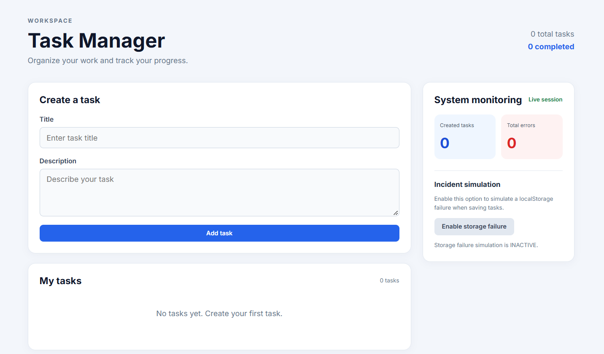
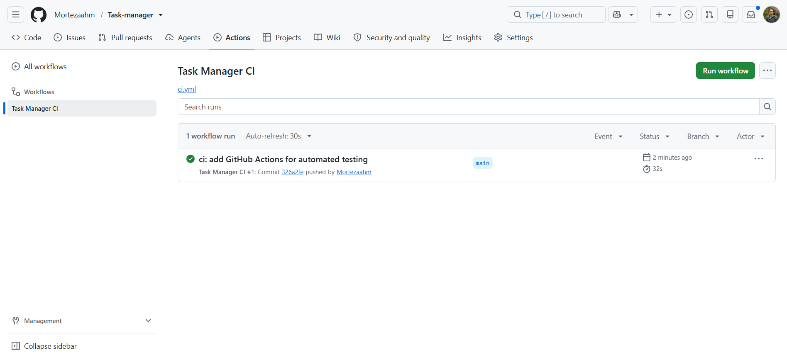
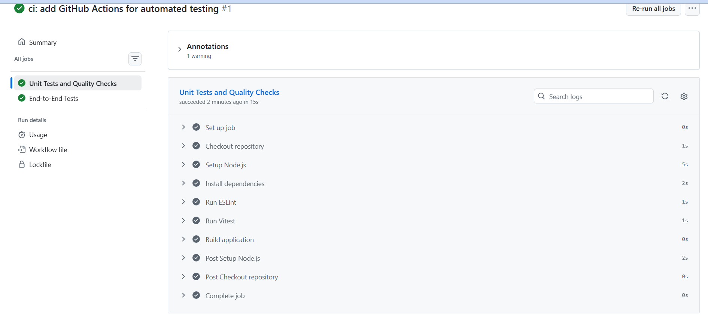
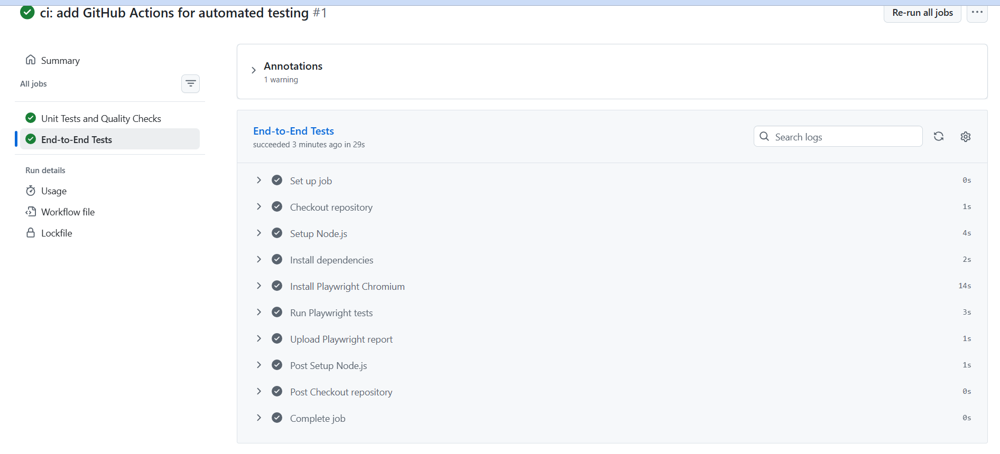
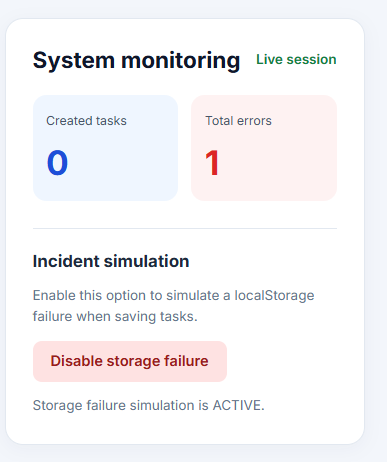

# Task Manager

[](https://github.com/Mortezaahm/Task-manager/actions/workflows/ci.yml)

A simple task management application built with React and JavaScript. The project focuses on software quality through automated testing, logging, monitoring, and incident handling.

## Project Overview

Task Manager allows users to create, manage, and track their tasks through a simple and responsive interface.

Tasks are stored in the browser's `localStorage`, so they remain available after refreshing the page.

The project was developed as part of the Software Life Cycle Management course, with a particular focus on automated quality assurance.

## Features

### Task Management

- Create tasks with a title and description.
- View all created tasks.
- Mark tasks as completed.
- Delete tasks.
- Track task status:
  - **Ongoing** – In Progress
  - **Completed** – Completed
- Persist tasks using browser `localStorage`.
- Restore saved tasks after a page reload.
- Validate task titles and reject empty or whitespace-only values.

### Logging

The application includes a centralized logging service.

The following events are logged:

- Task creation.
- Task completion.
- Task deletion.
- Application and storage errors.

Logs are displayed in the browser console and include ISO 8601 timestamps.

Example:

```text
[INFO] 2026-11-21T18:30:15.000Z - Task created: "Learn Vitest"
[INFO] 2026-11-21T18:32:10.000Z - Task deleted: "Learn Vitest"
[ERROR] 2026-11-21T18:35:20.000Z - Failed to create task: Simulated storage failure.
```

### Monitoring

A monitoring panel displays:

- Number of successfully created tasks.
- Number of errors encountered during the current application session.

The counters are updated when relevant events occur.

Monitoring metrics are maintained in memory and reset when the page is reloaded. Task data itself is stored separately in `localStorage`.

### Incident Simulation

The application includes a controlled storage failure simulation.

When enabled:

1. Attempts to save tasks fail intentionally.
2. An error message is displayed to the user.
3. An ERROR log is written to the browser console.
4. The error counter increases.
5. The task is not added to the task list.
6. The created-task counter remains unchanged.

The simulation can be disabled at any time. After disabling it, task creation works normally again.

## Technologies

| Technology     | Purpose                           |
| -------------- | --------------------------------- |
| React          | User interface                    |
| JavaScript     | Application logic                 |
| Vite           | Development server and build tool |
| localStorage   | Client-side data persistence      |
| Vitest         | Unit testing                      |
| Playwright     | End-to-End testing                |
| ESLint         | Code quality and static analysis  |
| GitHub Actions | Continuous Integration (CI)       |

## Project Structure

```text
task-manager/
│
├── .github/
│   └── workflows/
│       └── ci.yml
│
├── docs/
│   └── screenshots/
│
├── public/
│
├── src/
│   ├── components/
│   │   ├── MonitoringPanel.jsx
│   │   ├── TaskForm.jsx
│   │   ├── TaskItem.jsx
│   │   └── TaskList.jsx
│   │
│   ├── services/
│   │   ├── logger.js
│   │   ├── monitoringService.js
│   │   ├── storageService.js
│   │   └── taskService.js
│   │
│   ├── App.jsx
│   ├── App.css
│   ├── index.css
│   └── main.jsx
│
├── tests/
│   ├── unit/
│   │   ├── storageService.test.js
│   │   └── taskService.test.js
│   │
│   └── e2e/
│       └── task-manager.spec.js
│
├── .gitignore
├── index.html
├── package.json
├── package-lock.json
├── playwright.config.js
├── vite.config.js
└── README.md
```

## Getting Started

### Prerequisites

- Node.js 24
- npm
- Git

### Installation

Clone the repository:

```bash
git clone https://github.com/Mortezaahm/Task-manager.git
```

Navigate to the project directory:

```bash
cd Task-manager
```

Install dependencies:

```bash
npm ci
```

Install the Playwright Chromium browser:

```bash
npx playwright install chromium
```

### Start the Application

Run the development server:

```bash
npm run dev
```

Open the application:

```text
http://localhost:5173
```

## Automated Testing

The project uses Vitest for unit testing and Playwright for End-to-End testing.

### Unit Tests – Vitest

Run all unit tests once:

```bash
npm run test:run
```

Start Vitest in watch mode:

```bash
npm run test
```

The unit tests cover:

| Test | Description                                               |
| ---- | --------------------------------------------------------- |
| 1    | Create a task with correct information                    |
| 2    | Reject a task without a title                             |
| 3    | Mark a task as completed                                  |
| 4    | Delete a task                                             |
| 5    | Calculate the number of completed tasks                   |
| 6    | Reject titles containing only whitespace                  |
| 7    | Handle an unknown task ID without changing existing tasks |
| 8    | Handle errors when localStorage fails                     |

**Total: 8 unit tests.**

### End-to-End Tests – Playwright

Run all E2E tests:

```bash
npm run test:e2e
```

Run tests using a single worker:

```bash
npm run test:e2e -- --workers=1
```

Open Playwright UI mode:

```bash
npm run test:e2e:ui
```

Open the HTML test report:

```bash
npm run test:e2e:report
```

The E2E tests cover:

| Test | Description                                                                  |
| ---- | ---------------------------------------------------------------------------- |
| 1    | Create a task and verify that it appears in the list                         |
| 2    | Mark a task as completed and verify its status                               |
| 3    | Delete a task and verify that it is removed                                  |
| 4    | Verify that tasks remain after a page reload                                 |
| 5    | Simulate a storage failure, verify monitoring information, and test recovery |

**Total: 5 E2E tests.**

## Code Quality and Production Build

Run ESLint:

```bash
npm run lint
```

Create a production build:

```bash
npm run build
```

Preview the production build:

```bash
npm run preview
```

## GitHub Actions – Continuous Integration

GitHub Actions is configured to automatically run quality checks and automated tests.

The workflow is located at:

```text
.github/workflows/ci.yml
```

The workflow is triggered by:

- Push to the `main` branch.
- Pull requests targeting the `main` branch.
- Manual execution using `workflow_dispatch`.

### Workflow Jobs

**1. Unit Tests and Quality Checks**

- Check out the repository.
- Set up Node.js 24.
- Install dependencies using `npm ci`.
- Run ESLint.
- Execute Vitest unit tests.
- Build the application.

**2. End-to-End Tests**

- Check out the repository.
- Set up Node.js 24.
- Install dependencies.
- Install Playwright and Chromium.
- Execute all Playwright E2E tests.
- Upload the Playwright report as a GitHub Actions artifact.

Both jobs run independently. GitHub Actions clearly reports whether each job succeeds or fails.

[View GitHub Actions](https://github.com/Mortezaahm/Task-manager/actions)
[View a successful Actions](https://github.com/Mortezaahm/Task-manager/actions/runs/44933491560)

## Test Results

The following results were obtained from the completed local test runs and the successful GitHub Actions execution.

| Quality Check               | Result     |
| --------------------------- | ---------- |
| ESLint                      | Passed     |
| Vitest                      | 8/8 passed |
| Playwright                  | 5/5 passed |
| Production Build            | Passed     |
| GitHub Actions – Unit Tests | Passed     |
| GitHub Actions – E2E Tests  | Passed     |

**Total automated tests: 13**

All required automated tests passed in the completed test runs.

### Rationale for Additional VG Tests

The additional tests were selected to cover important edge cases and situations that could cause problems in a real application.

**Additional Unit Tests:**

- **Whitespace-only title:** Verifies that titles containing only spaces are rejected, preventing invalid tasks from being created.
- **Unknown task ID:** Ensures that attempting to update a non-existing task does not accidentally modify other tasks.
- **Storage failure:** Verifies that the application correctly handles errors from localStorage instead of silently failing.

**Additional E2E Tests:**

- **Persistence after reload:** Verifies that task data is actually stored and restored correctly after refreshing the browser.
- **Storage failure and recovery:** Verifies the complete incident handling flow, including error messages, monitoring counters, prevention of unsuccessful task creation, and successful recovery.

These tests were selected to improve reliability, validate error handling, and ensure that the application behaves correctly under both normal and exceptional conditions.

## Incident Description and Handling

### Simulated Incident

A controlled storage failure was introduced to simulate a situation where the application cannot save a new task.

The failure is activated through the monitoring panel using the storage failure simulation control.

When the simulation is enabled, the storage service intentionally throws an error instead of saving the task.

### How the Incident Was Detected

The incident was detected through multiple mechanisms:

1. The application displayed an error message to the user.
2. The browser console recorded an ERROR log with a timestamp.
3. The monitoring panel increased the error counter.
4. The failed task was not added to the task list.
5. The created-task counter remained unchanged.

### Recovery

After disabling the simulated storage failure, a new task was created successfully.

The application returned to normal operation.

The monitoring information showed:

- Created tasks increased after the successful operation.
- The previous error remained recorded in the current session.
- The error counter was not incorrectly reset during recovery.

The recovery process was verified through manual testing and the Playwright E2E test.

## Analysis and Reflection

### 1. Which types of errors were discovered by unit tests and E2E tests?

Unit tests helped verify individual functions and business logic, including task creation, input validation, task status changes, deletion, counting completed tasks, and storage error handling.

E2E tests verified complete user workflows in a real browser. They helped identify issues related to UI interaction, task persistence, monitoring counters, and incident recovery.

### 2. How did logging help identify the incident?

The centralized logger recorded the storage failure as an ERROR event with a timestamp and a description of the problem.

This made it possible to identify when the incident occurred and understand which operation had failed.

### 3. What could be observed through monitoring?

The monitoring panel displayed the number of successfully created tasks and the number of errors.

During the simulated incident, the error counter increased while the created-task counter remained unchanged.

After recovery, a successful task creation increased the created-task counter, while the previous error remained recorded.

### 4. How was the resolution verified?

The simulated failure was disabled and a new task was created successfully.

The task appeared in the list, the created-task counter increased, and the error counter retained the previous incident.

The E2E tests also verified successful task creation after recovery and persistence after page reload.

### 5. How could testing and monitoring be improved in a larger system?

In a larger application, testing and monitoring could be improved through:

- Integration tests for communication between frontend and backend services.
- Additional E2E tests across different browsers and devices.
- Structured logging with additional contextual information.
- Centralized log management and error tracking.
- Persistent monitoring metrics and historical dashboards.
- Alerts when error rates exceed predefined thresholds.
- Correlation IDs to connect related events across services.
- Performance and load testing.

These improvements would make it easier to detect, investigate, and resolve incidents in production environments.

## Screenshots and Documentation

Screenshots from the application, test executions, GitHub Actions, and incident simulation are stored in:

```text
docs/screenshots/
```

The screenshots document:

- The Task Manager application.
- Successful GitHub Actions workflow execution.
- Unit test execution results.
- Playwright E2E test execution results.
- Incident simulation and monitoring information.











## Limitations

This project uses browser `localStorage` instead of a backend or database.

Task information is therefore stored locally in the browser and is not synchronized between different devices or users.

Monitoring counters are maintained in memory for the current application session and reset after a page reload.

The incident simulation is intended for controlled testing and demonstration, not as a production error simulation mechanism.

## Repository

GitHub: https://github.com/Mortezaahm/Task-manager

---

**Project:** Task Manager
**Course:** Software Life Cycle Management
**Focus:** Automated Testing, Logging, Monitoring, Incident Handling, and Continuous Integration.
**Author:** Morteza Ahmadianmanzary
